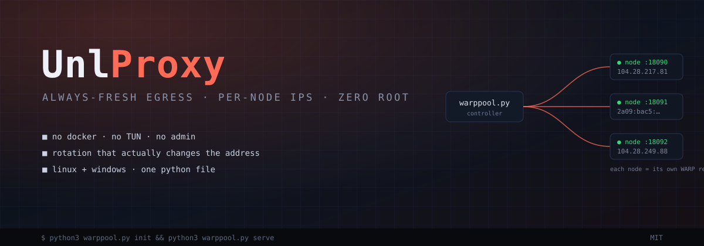
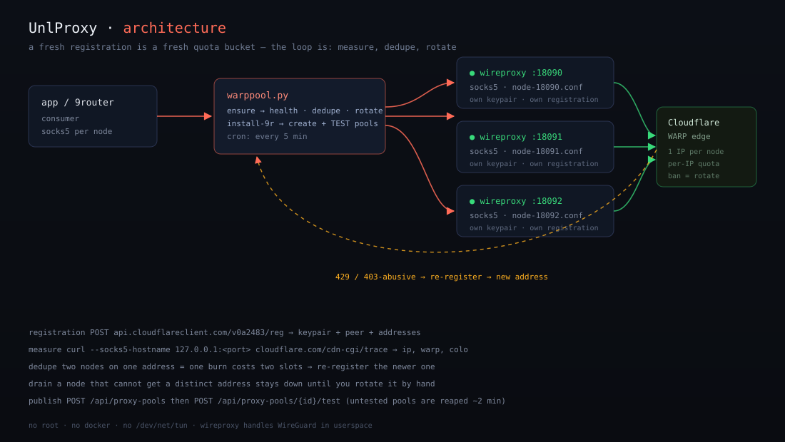

<div align="center">



**UnlProxy** — an always-fresh egress pool with a healthy IP guarantee.

No docker · no TUN · no admin · one Python file · Linux & Windows

</div>

---

## Setup — 3 answers, done

```bash
python3 warppool.py setup
```

Asks:

1. **Where does this run?** `server` (default) · `windows-desktop` · `iran`
2. **How many egress nodes?** (3 is a fine start)
3. **Start the control UI?** (Y)

Everything else is automatic: wireproxy is downloaded, WARP nodes register,
egress is measured and deduped, and in `iran` mode it asks only for your two
v2ray ports (socks inbound + dokodemo relay). For 9router users, tick
"push pools to 9router" inside the **manage** dialog — or set
`"nine_router": {"enabled": true}` once in `config.json`.

`server` mode ends with the pool up and, if you chose it, the UI running.

## Manage (UI)

Open `http://127.0.0.1:8180/` — node cards with live egress IPs, a stat strip,
an event console, rotate buttons, and a **manage** dialog for:

- node count (grow the pool without restarts)
- rotation interval
- 9router publishing (create + test, idempotent)
- restricted-network values (v2ray socks + UDP relay) — one place, no config editing

---

## Why

Rate limits and IP bans on anonymous free tiers are a function of your **egress
address**, so the fix is an address that is never the same for long:

> every node = its own WARP registration = its own egress IP.
> Rotation is a fresh registration, and dedupe guarantees nodes never
> collapse onto the same address.

Mechanics follow [ebouther/opencode-unlimited-proxy](https://github.com/ebouther/opencode-unlimited-proxy)
(MIT), re-implemented portable and dependency-free: wireproxy does the WireGuard
side in userspace (SOCKS5), so there is nothing to install beyond Python and curl.

## How it works

- **rotate** — re-register a node (new device identity). If Cloudflare hands
  back the same address, up to 3 retries until the address actually changes.
- **dedupe** — measure every node's real egress (`cloudflare.com/cdn-cgi/trace`
  through its own socks endpoint). Two nodes sharing an address cost two slots
  for one quota bucket, so the newer one is re-registered; a node that cannot
  get a distinct address is *drained* (stopped) instead of lying in the pool.
- **health** — a node that stopped answering is restarted; registration backs
  off hard after Cloudflare 429/403.
- **publish** — every healthy node becomes a `proxyPool` in
  [9router](https://github.com/a2z05/9router): created, then **tested**
  immediately, because the router reaps pools created-but-never-tested
  (~2 minutes).

<p align="center">

</p>

## Windows

Same `setup`. Double-click `run.bat` (installs nothing but wireproxy) or run
`python3 warppool.py setup` from a terminal — the `windows-desktop` answer is
the same flow, and manage-everything lives in the UI.

## Iran / restricted networks

Answer `iran` in setup and type your two v2ray ports; same values are editable
later in the UI manage dialog without touching `config.json`.

## Commands

| command             | job |
|---------------------|-----|
| `setup`             | one command: 3 answers, config + wireproxy + nodes + (optional) UI |
| `init`              | headless setup (no questions) — config, wireproxy, bring nodes up |
| `ensure`            | health + dedupe + rotations due (cron entry) |
| `up` / `down`       | start / stop every node |
| `rotate [port|all]` | force a fresh registration now (up to 3 tries for a distinct address) |
| `status`            | JSON table of nodes |
| `cron`-watch        | `scripts/warp_pool_watch.sh` every 5 min: ensure + 9r sync + alert on dead pool |
| `serve`             | local UI (dark, auto-refresh, rotate + manage dialog) |
| `install-9r`        | create + test pool entries in 9router |

## Notes

- A node that cannot distinguish its address stays `drained` until you rotate it by hand.
- Everything that used to be hand-edited in `config.json` is now in the UI manage dialog;
  the file is a fallback only.

## Resource footprint

Measured on a live 3-node pool (idle traffic + one chat request through it):

| piece                | RAM    | CPU          |
|----------------------|--------|--------------|
| each wireproxy node  | ~38–41 MB | 0.2–0.3 % of one core |
| UI (`serve`)         | ~24 MB | ~0 %         |
| **3-node pool total**| **~145 MB** | **<1 %** |

Extra nodes are ~40 MB + near-zero CPU each. Registration and trace probes fire
only on the 5-minute cron tick, so the idle cost is just the WireGuard keepalive
packets (25 s cadence, ~a few KB/s per node). 3 nodes is comfortably under
50 MB/thread budget of a small VPS; 8 nodes still fit a 512 MB box with the UI.

## License

MIT.
